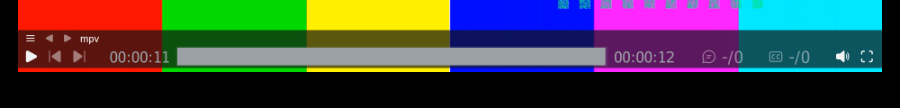

# YTFrame

**A borderless, video-only YouTube window for Windows.**

Paste a link, press Enter, and the window becomes the video — no title bar, no ads, no YouTube branding. mpv does the decoding, so resizing keeps the video's exact aspect ratio. Move the mouse to the bottom of the video when you want controls; they fade away again.

**[Download the latest release](https://github.com/cbrules3033/ytframe/releases/latest)** — extract the zip anywhere and run `YTFrame.exe`.


## Why this exists

The official YouTube player always brings its own chrome: title, share button, watch-later, end cards, recommendations, and ads. Embedding it in a custom window doesn't remove any of that, and a lot of videos have embedding disabled.

YTFrame instead hands the link to [mpv](https://mpv.io) via [yt-dlp](https://github.com/yt-dlp/yt-dlp) and displays the raw stream. The result is literally just the picture, at any size you want.

## Features

- **Video only.** No window border, no permanent controls, no ads.
- **Aspect-locked resizing.** Drag any edge or corner; the window always matches the video's ratio. Works for widescreen, vertical videos and Shorts.
- **Hover controls.** Move the pointer near the bottom of the video and a slim bar fades in: play/pause, seek bar with time and chapters, volume, fullscreen, previous/next. It fades out after a second. There is a tray toggle to turn it off.
- **Resume.** Picks up where you left off in normal videos. Live streams never resume, and a timestamp in the link always wins.
- **Quality picker.** Best / 1080p / 720p / 480p from the tray. Switching mid-video reloads at the same spot.
- **SponsorBlock.** Skips sponsor, self-promo and interaction segments on YouTube videos. Opt-out from the tray.
- **Live streams.** Reconnects after a drop, and shows a friendly message when a stream hasn't started or has ended.
- **Portable.** No installer, no registry, no admin rights. Settings, history and logs sit next to the exe; if the folder is read-only they go to `%LOCALAPPDATA%\YTFrame`.
- **Tray and hotkeys.** Ctrl+Alt+V for the paste bar, Ctrl+Alt+Space to play/pause, Ctrl+Alt+J/L to seek, Ctrl+Alt+M to mute.

## Download and run

1. Download `YTFrame-win64.zip` from the [latest release](https://github.com/cbrules3033/ytframe/releases/latest).
2. Extract it anywhere — Desktop, a USB stick, a synced folder.
3. Run `YTFrame.exe`.

Windows SmartScreen will warn on first run because the exe is unsigned: click **More info → Run anyway**. There is no admin prompt.

Requirements: Windows 10 or 11, 64-bit.

## Using it

| What | How |
| --- | --- |
| Play a link | Paste it into the bar and press **Enter** (or click **Play**) |
| Change the video | **Ctrl+Alt+V**, paste, Enter — or **Ctrl+V** in the video window |
| Controls | Move the pointer to the bottom of the video |
| Move the window | Drag anywhere on the video |
| Resize | Drag any edge or corner (the video's aspect is preserved) |
| Fullscreen | **Double-click** the video, or **F**; **Esc** leaves it |
| Pause | **Space** or **Ctrl+Alt+Space** |
| Seek | **← / →**, or **Ctrl+Alt+J / Ctrl+Alt+L** for 10 seconds |
| Volume | **↑ / ↓** or the mouse wheel |
| Mute | **M** or **Ctrl+Alt+M** |
| Speed | **[ / ]** |
| Start over | **Home** |
| Player menu | Right-click the video (mpv's menu: tracks, speed, quit, …) |
| App menu | Right-click the tray icon (quality, resume, SponsorBlock, …) |
| Close the paste bar | **Esc** or the **×** |
| Quit | Close the video window, press **Q** while it's focused, or tray → Exit |



The control bar only appears while the pointer is near it. Moving the mouse over the middle of the video to drag or resize it leaves the picture completely clean.

## Resume

For videos longer than a minute, YTFrame saves your position every few seconds and when you pause or quit. Open the same video again and it continues from there. It won't resume if you were within ~20 seconds of the end, if the link contains a timestamp (`&t=`), or if the stream is live. Tray → **Resume playback** turns this off; **Home** always starts from the beginning.

## Quality

Tray → **Quality** offers Best, 1080p, 720p and 480p. Changing it while a video is playing reloads the stream at the same timestamp — expect a brief black flash while yt-dlp resolves the new format. Live streams reload at the live edge. The choice is remembered for next time.

## SponsorBlock

YTFrame asks the [SponsorBlock](https://sponsor.ajay.app) API for the current YouTube video ID and skips **sponsor**, **self-promo** and **interaction** segments as playback reaches them. It only runs for normal YouTube videos (not live streams or playlists), never skips while you're paused or dragging the seek bar, and can be switched off from the tray.

Privacy: only the YouTube video ID is sent to `sponsor.ajay.app`. No account, no cookies, no other data.

## Live streams

Live links work the same way. The window stays at the stream's aspect ratio, seeking moves within the DVR buffer when the stream provides one, and a dropped stream is retried a couple of times before showing an error. A scheduled stream that hasn't started yet shows *"This stream hasn't started yet"* rather than a raw error.

Live latency is whatever YouTube serves — typically 10–20 seconds behind the live edge.

## When YouTube breaks

YouTube changes things regularly. If a video suddenly refuses to play, right-click the tray icon and choose **Update yt-dlp**. It updates the bundled `yt-dlp.exe` in place (no admin needed), and playback usually works again immediately.

## Files in the folder

```
YTFrame.exe      the app
mpv.exe          playback engine
yt-dlp.exe       link resolver
settings.json    created on first run
history.json     resume positions and titles
ytframe.log      app log
mpv.log          player log (useful for playback problems)
```

Delete the folder to uninstall. Nothing is left behind (unless the folder was read-only, in which case `%LOCALAPPDATA%\YTFrame` contains the settings, history and logs).

## Troubleshooting

- **The control bar doesn't appear** — move the pointer into the bottom third of the video, over the picture itself. Tray → **Show controls on hover** must be checked. If you turned it off, keyboard and tray controls still work.
- **"Couldn't play that link"** — try **Update yt-dlp** from the tray. Private videos, members-only videos, age-restricted videos and DRM'd YouTube Movies are not supported.
- **Quality switch flashes black** — normal; yt-dlp is resolving the new stream.
- **Resume didn't kick in** — only videos over a minute, not near the end, no `&t=` timestamp in the link, and never for live streams.
- **SponsorBlock didn't skip** — segments are community-submitted; not every video has them. The tray toggle must be on.
- **No tray icon** — Windows may have hidden it; check the overflow area. Ctrl+Alt+V still works.
- **Antivirus complaint** — the exe is an unsigned Go binary. Build it yourself with `scripts/build.sh` if you prefer.
- **Audio device changes** — restart the app; mpv picks up the new default device.

## Build from source

You need Go 1.19+ and the bundled binaries in `vendor/`:

```
vendor/mpv.exe      (Windows build, 64-bit)
vendor/yt-dlp.exe
```

Then:

```bash
CGO_ENABLED=0 GOOS=windows GOARCH=amd64 go build \
  -buildvcs=false -trimpath -ldflags "-H windowsgui -s -w" \
  -o dist/YTFrame-win64/YTFrame.exe ./cmd/ytframe
```

`scripts/build.sh` does the full package (build, copy mpv/yt-dlp, zip, checksum). The Windows icon, version info and DPI manifest are compiled from `cmd/ytframe/app.rc` into `rsrc.syso`; that file is committed so the build does not need MinGW. To change the icon or manifest, regenerate it with:

```bash
x86_64-w64-mingw32-windres -i cmd/ytframe/app.rc -O coff -o cmd/ytframe/rsrc.syso
```

## Credits and licences

- **mpv** — GPLv2+; <https://github.com/mpv-player/mpv>. Bundled Windows build by [zhongfly/mpv-winbuild](https://github.com/zhongfly/mpv-winbuild).
- **yt-dlp** — Unlicense; <https://github.com/yt-dlp/yt-dlp>.
- **SponsorBlock** — segment data by <https://sponsor.ajay.app>.
- **YTFrame** — MIT; see `LICENSE`.

Exact bundled versions and source links are in `SOURCES.txt` inside the release zip.

Using yt-dlp to watch YouTube videos is against YouTube's terms of service in the strict reading. This project is for personal, video-only viewing.
