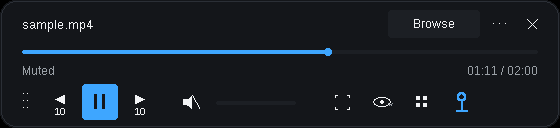

# YTFrame

**A borderless, video-only YouTube window for Windows — with a floating remote and a built-in browser.**

Paste a link or browse YouTube, click a video, and it plays in a window that is nothing but picture. Drag any edge to resize; the video's aspect ratio stays perfect. The controls live in their own small, always-on-top bar, so they stay usable even when the video is tiny.

**[Download the latest release](https://github.com/cbrules3033/ytframe/releases/latest)** — extract the zip anywhere and run `YTFrame.exe`.

**New in 1.3:** a redesigned launcher with one-click browsing, a clearer remote with the video title and control hints, keyboard navigation, and fixes for timestamp reloads, dragging, monitor restoration and read-only folders.




## Why this exists

The official YouTube player always brings its own chrome: title, share button, watch-later, end cards, recommendations, and ads. Embedding it in a custom window doesn't remove any of that, and a lot of videos have embedding disabled.

YTFrame hands the video to [mpv](https://mpv.io) via [yt-dlp](https://github.com/yt-dlp/yt-dlp) and shows the raw stream. A separate borderless browser window lets you browse the real YouTube site and sends whatever you click to the player.

## Features

- **Video only.** No window border, no player chrome, no ads in the player.
- **Floating control bar.** Its own small window: play/pause, ±10s, seek, time, volume, fullscreen, video mode, layouts, pin, Browse, hide. Free-floating, always on top by default, never steals focus.
- **Three video modes.** Show always · Hide on pause · Always hidden (audio-only). The bar stays as the remote when the picture is hidden.
- **Five layouts.** Save the video window and bar positions into slots, apply them with `Ctrl+Alt+1…5`, save with `Ctrl+Alt+Shift+1…5`, and mark one as the startup default.
- **Browse YouTube.** A borderless custom window with the real YouTube site (home, search, channels, recommendations). Clicking a video sends it to the player. Uses the system Edge WebView2 runtime; profile and logins live in `browse-data/`.
- **Aspect-locked resizing.** Drag any edge or corner; the window always matches the video's ratio, including vertical videos and Shorts.
- **Resume.** Normal videos pick up where you left off. Live streams never resume, and a `&t=` timestamp wins.
- **Quality picker.** Best / 1080p / 720p / 480p from the tray, reloading at the same spot.
- **SponsorBlock.** Skips sponsor, self-promo and interaction segments on YouTube videos.
- **Live streams.** Reconnects after a drop, and shows a friendly message when a stream hasn't started or has ended.
- **Portable.** No installer, no registry, no admin rights. Settings, history and logs sit next to the exe; if the folder is read-only they go to `%LOCALAPPDATA%\YTFrame`.

## Download and run

1. Download `YTFrame-win64.zip` from the [latest release](https://github.com/cbrules3033/ytframe/releases/latest).
2. Extract it anywhere — Desktop, a USB stick, a synced folder.
3. Run `YTFrame.exe`.

Windows SmartScreen will warn on first run because the exe is unsigned: click **More info → Run anyway**. There is no admin prompt.

Requirements: Windows 10 or 11, 64-bit. YouTube browsing needs the Microsoft Edge WebView2 Runtime, which is normally already installed with Edge; if not, the browser window offers a download link.

## Using it

| What | How |
| --- | --- |
| Play a link | Paste it into the bar and press **Enter** |
| Browse YouTube | Tray → **Browse YouTube…**, or the bar's Browse button |
| Show/hide the control bar | **Ctrl+Alt+B** or tray → **Control bar** |
| Move/resize the video | Drag the video / drag any edge or corner |
| Fullscreen | **Double-click** the video, or **F**; **Esc** leaves it |
| Pause | **Space** or **Ctrl+Alt+Space**; in Hide-on-pause mode the picture hides, the bar stays |
| Seek | **← / →**, the bar's seek line, or **Ctrl+Alt+J / Ctrl+Alt+L** |
| Volume | **↑ / ↓**, the mouse wheel, or the bar's slider |
| Mute | **M** or **Ctrl+Alt+M** |
| Video mode | The eye button on the bar, or tray → **Video** |
| Layouts | The grid button on the bar, tray → **Layouts**, or the layout hotkeys |
| Pin the bar | The pin button or bar menu → **Control bar always on top** |
| Speed | **[ / ]** |
| Start over | **Home** |
| Player menu | Right-click the video (mpv's menu) |
| App menu | Right-click the tray icon |
| Close the paste bar | **Esc** or the **×** |
| Quit | Close the video window, press **Q** while it's focused, or tray → Exit |

## The control bar

The remote has a title row, a dedicated timeline and generously spaced playback controls. Hover an icon to see its action and shortcut. The bar is a separate window, so it can be larger than a tiny video and remains readable at any size. It is always on top by default (the pin toggles it) and uses `WS_EX_NOACTIVATE`, so clicking it never steals focus from the video, a fullscreen app, or your work.

- The seek line is clickable and draggable; the time updates live.
- The volume slider is clickable/draggable; the wheel over the bar also adjusts volume.
- The eye button cycles **Show always → Hide on pause → Always hidden (audio only)**.
- The grid button opens the five layout slots.
- The pin toggles the bar's always-on-top.
- The overflow menu (⋯) has radio versions of the video modes, the two always-on-top toggles, layouts, in-video controls, Browse and Hide.

The in-video mpv controls are off by default (they're unusable on tiny windows); tray → **In-video controls** brings them back.

## Layouts

Five slots, each storing the video window rect and the control-bar position.

- Tray → **Layouts** or the bar's grid button: apply a slot, save the current arrangement into a slot, mark a default, or clear all.
- `Ctrl+Alt+1…5` applies a layout.
- `Ctrl+Alt+Shift+1…5` saves the current arrangement.
- The **default** slot is applied at startup / when the first video window appears. Manual resizes during the session are remembered; the default only overrides at startup.
- Applying a layout while a video plays exits fullscreen if needed, honors the saved width and top-left, recomputes the height for the current video's aspect, and clamps to the monitor.

## YouTube browser

Tray → **Browse YouTube…** opens a borderless custom window with a 52px dark toolbar and the real YouTube site below it. Clicking a video (or Shorts) sends it to the player and closes the browser; the control bar returns.

- Back/forward/reload/home buttons; `Alt+←/→` and `Alt+Home` also work.
- The browse profile is stored in `browse-data/` next to the exe, so logins and cookies survive restarts. Tray → **Clear YouTube browsing data** removes it.
- If the WebView2 runtime is missing, the window shows a **Get WebView2** button and the player still works without it.
- YouTube ads and tracking exist inside the browse window; the player itself stays ad-free.
- Google sometimes blocks sign-in inside embedded browsers; if that happens, browsing works logged out, but subscriptions won't.

## Resume, quality and SponsorBlock

- **Resume** saves your position in normal videos and resumes on the next open. It won't resume live streams, videos within ~20 seconds of the end, or links with a `&t=` timestamp. Tray toggle; `Home` starts over.
- **Quality** reloads at the same timestamp (brief black flash) and is remembered.
- **SponsorBlock** skips sponsor, self-promo and interaction segments on YouTube VODs; silent, opt-out in the tray, and only the video ID goes to `sponsor.ajay.app`.

## Live streams

Live links work the same way. The window stays at the stream's aspect ratio, seeking moves within the DVR buffer when available, and a dropped stream is retried. A scheduled stream that hasn't started shows *"This stream hasn't started yet"*. Live latency is whatever YouTube serves — typically 10–20 seconds behind the live edge.

## When YouTube breaks

Right-click the tray icon and choose **Update yt-dlp**. It updates the bundled `yt-dlp.exe` in place (no admin needed), and playback usually works again immediately.

## Files in the folder

```
YTFrame.exe      the app
mpv.exe          playback engine
yt-dlp.exe       link resolver
settings.json    created on first run
history.json     resume positions and titles
browse-data/     WebView2 profile (logins/cookies)
ytframe.log      app log
mpv.log          player log
```

Delete the folder to uninstall. Nothing is left behind (unless the folder was read-only, in which case `%LOCALAPPDATA%\YTFrame` holds the settings, history, logs and browser profile).

## Troubleshooting

- **The control bar doesn't appear** — press `Ctrl+Alt+B` or use tray → **Control bar**. It only shows while a video is loaded.
- **Hide on pause doesn't hide the picture** — make sure the control bar is visible (the bar is the remote); with the bar hidden, pausing intentionally leaves the frame visible.
- **A layout feels off** — layouts store the width and top-left; the height is recomputed for the current video's aspect so the picture never gets bars. Save again after positioning the bar.
- **Browse says WebView2 is missing** — install Microsoft's WebView2 Runtime from the button in that window, then reopen Browse.
- **YouTube sign-in fails in Browse** — Google blocks some embedded-browser logins; log in with your normal browser or use the paste bar for individual links.
- **"Couldn't play that link"** — try **Update yt-dlp**. Private, members-only, age-restricted and DRM'd videos are not supported.
- **No tray icon** — check the overflow area; `Ctrl+Alt+V` and `Ctrl+Alt+B` still work.
- **Antivirus complaint** — the exe is an unsigned Go binary. Build it yourself with `scripts/build.sh` if you prefer.

## Build from source

You need Go 1.19+ and the bundled binaries in `bundle/`:

```
bundle/mpv.exe      (Windows build, 64-bit)
bundle/yt-dlp.exe
```

Then:

```bash
go mod download
CGO_ENABLED=0 GOOS=windows GOARCH=amd64 go build \
  -buildvcs=false -trimpath -ldflags "-H windowsgui -s -w" \
  -o dist/YTFrame-win64/YTFrame.exe ./cmd/ytframe
```

`scripts/build.sh` does the full package (build, copy mpv/yt-dlp, zip, checksum). On Windows, use `scripts/package.ps1`; it downloads the pinned dependencies and verifies their SHA-256 hashes. Both stage fresh packages under `dist/staging/` so rebuilding does not erase an existing portable installation under `dist/YTFrame-win64/`.

The [Windows build workflow](.github/workflows/windows.yml) runs regression tests and uploads an unsigned ZIP and checksum for each build. To run checks locally on Windows:

```powershell
go test -count=1 ./cmd/ytframe
go vet -unsafeptr=false ./cmd/ytframe
```

The `unsafeptr` analyzer is excluded because Win32 callbacks deliver pointers through `uintptr`. All other vet checks run. The Windows icon, version info and DPI manifest are compiled from `cmd/ytframe/app.rc` into `rsrc.syso`; that file is committed so the build does not need MinGW. To change the icon or manifest, regenerate it with:

```bash
x86_64-w64-mingw32-windres -i cmd/ytframe/app.rc -O coff -o cmd/ytframe/rsrc.syso
```

The WebView2 wrapper is a small patched copy of [go-webview2](https://github.com/jchv/go-webview2) under `third_party/` (MIT); the patch lets it embed into our own borderless host window. `go-webview2` embeds the WebView2Loader DLL, so no extra files are shipped.

## Code signing policy

Current builds are unsigned. See the [code signing policy and free signing setup](docs/CODE_SIGNING.md) for the project's release policy, dependency disclosures and the SignPath Foundation application details. Signing requires provider approval and maintainer account setup; no approval or signature is claimed.

## Credits and licences

- **mpv** — GPLv2+; <https://github.com/mpv-player/mpv>. Bundled Windows build by [zhongfly/mpv-winbuild](https://github.com/zhongfly/mpv-winbuild).
- **yt-dlp** — Unlicense; <https://github.com/yt-dlp/yt-dlp>.
- **go-webview2** — MIT; <https://github.com/jchv/go-webview2>. Patched copy in `third_party/`.
- **Microsoft Edge WebView2** — the browse window uses the system WebView2 Runtime; <https://developer.microsoft.com/microsoft-edge/webview2/>.
- **SponsorBlock** — segment data by <https://sponsor.ajay.app>.
- **YTFrame** — MIT; see `LICENSE`.

Exact bundled versions and source links are in `SOURCES.txt` inside the release zip.

Using yt-dlp to watch YouTube videos is against YouTube's terms of service in the strict reading. This project is for personal, video-only viewing.
