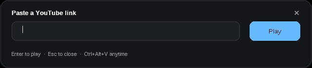

# YTFrame

**A borderless, video-only YouTube window for Windows.**

Paste a link, press Enter, and the window becomes the video — no title bar, no player controls, no ads, no YouTube branding. mpv does the decoding, so resizing keeps the video's exact aspect ratio.

**[Download the latest release](https://github.com/cbrules3033/ytframe/releases/latest)** — extract the zip anywhere and run `YTFrame.exe`.



## Why this exists

The official YouTube player always brings its own chrome: title, share button, watch-later, end cards, recommendations, and ads. Embedding it in a custom window doesn't remove any of that, and a lot of videos have embedding disabled.

YTFrame instead hands the link to [mpv](https://mpv.io) via [yt-dlp](https://github.com/yt-dlp/yt-dlp) and displays the raw stream. The result is literally just the picture, at any size you want.

## Features

- **Video only.** No window border, no controls, no OSD, no ads.
- **Aspect-locked resizing.** Drag any edge or corner; the window always matches the video's ratio. Works for widescreen, vertical videos and Shorts.
- **Live streams.** Plays YouTube live streams (and most other sites yt-dlp supports), reconnects after a drop, and shows a friendly message when a stream hasn't started or has ended.
- **Remembers everything.** Last link, window size, position, volume and always-on-top state.
- **Portable.** No installer, no registry, no admin rights. Settings and logs sit next to the exe; if the folder is read-only it falls back to `%LOCALAPPDATA%\YTFrame`.
- **Tray controls.** Pause, mute, fullscreen, always on top, update yt-dlp, open log, exit.
- **Global hotkey.** `Ctrl+Alt+V` opens the paste bar from anywhere.

## Download and run

1. Download `YTFrame-win64.zip` from the [latest release](https://github.com/cbrules3033/ytframe/releases/latest).
2. Extract it anywhere — Desktop, a USB stick, a synced folder.
3. Run `YTFrame.exe`.

Windows SmartScreen will warn on first run because the exe is unsigned: click **More info → Run anyway**. There is no admin prompt.

Requirements: Windows 10 or 11, 64-bit.

## Using it

| What | How |
| --- | --- |
| Play a link | Paste it into the bar and press **Enter** (or click **Play**) |
| Change the video | **Ctrl+Alt+V**, paste, Enter — or press **Ctrl+V** in the video window |
| Move the window | Drag anywhere on the video |
| Resize | Drag any edge or corner (the video's aspect is preserved) |
| Fullscreen | **Double-click** the video, or press **F**; **Esc** leaves fullscreen |
| Pause | **Space** |
| Seek | **← / →** |
| Volume | **↑ / ↓** or the mouse wheel |
| Mute | **M** |
| Player menu | Right-click the video (mpv's menu: tracks, speed, quit, …) |
| App menu | Right-click the tray icon |
| Close the paste bar | **Esc** or the **×** |
| Quit | Close the video window, press **Q** while it's focused, or tray → Exit |

The tray menu also has **Always on top**, **Update yt-dlp**, **Open log** and **About**.

## Live streams

Live links work the same way. The window stays at the stream's aspect ratio, seeking moves within the DVR buffer when the stream provides one, and a dropped stream is retried a couple of times before showing an error. A scheduled stream that hasn't started yet shows *"This stream hasn't started yet"* rather than a raw error.

Live latency is whatever YouTube serves — typically 10–20 seconds behind the live edge.

## When YouTube breaks

YouTube changes things regularly. If a video suddenly refuses to play, right-click the tray icon and choose **Update yt-dlp**. It updates the bundled `yt-dlp.exe` in place (no admin needed), and playback usually works again immediately.

## Files in the folder

```
YTFrame.exe      the app
mpv.exe          playback engine
yt-dlp.exe       link resolver
settings.json    created on first run
ytframe.log      app log
mpv.log          player log (useful for playback problems)
```

Delete the folder to uninstall. Nothing is left behind (unless the folder was read-only, in which case `%LOCALAPPDATA%\YTFrame` contains the settings and logs).

## Troubleshooting

- **"Couldn't play that link"** — try **Update yt-dlp** from the tray. Private videos, members-only videos, age-restricted videos and DRM'd YouTube Movies are not supported.
- **The window is black** — the stream may still be loading; look at the paste-bar status. Check `mpv.log` for the last error.
- **No tray icon** — Windows may have hidden it; check the overflow area. `Ctrl+Alt+V` still works.
- **Antivirus complaint** — the exe is an unsigned Go binary. Build it yourself with `scripts/build.sh` if you prefer.
- **Audio device changes** — restart the app; mpv picks up the new default device.

## Build from source

You need Go 1.19+ and the bundled binaries in `vendor/`:

```
vendor/mpv.exe      (Windows build, 64-bit)
vendor/yt-dlp.exe
```

Then:

```bash
CGO_ENABLED=0 GOOS=windows GOARCH=amd64 go build \
  -buildvcs=false -trimpath -ldflags "-H windowsgui -s -w" \
  -o dist/YTFrame-win64/YTFrame.exe ./cmd/ytframe
```

`scripts/build.sh` does the full package (build, copy mpv/yt-dlp, zip, checksum). The Windows icon, version info and DPI manifest are compiled from `cmd/ytframe/app.rc` into `rsrc.syso`; that file is committed so the build does not need MinGW. To change the icon or manifest, regenerate it with:

```bash
x86_64-w64-mingw32-windres -i cmd/ytframe/app.rc -O coff -o cmd/ytframe/rsrc.syso
```

## Credits and licences

- **mpv** — GPLv2+; <https://github.com/mpv-player/mpv>. Bundled Windows build by [zhongfly/mpv-winbuild](https://github.com/zhongfly/mpv-winbuild).
- **yt-dlp** — Unlicense; <https://github.com/yt-dlp/yt-dlp>.
- **YTFrame** — MIT; see `LICENSE`.

Exact bundled versions and source links are in `SOURCES.txt` inside the release zip.

Using yt-dlp to watch YouTube videos is against YouTube's terms of service in the strict reading. This project is for personal, video-only viewing.
